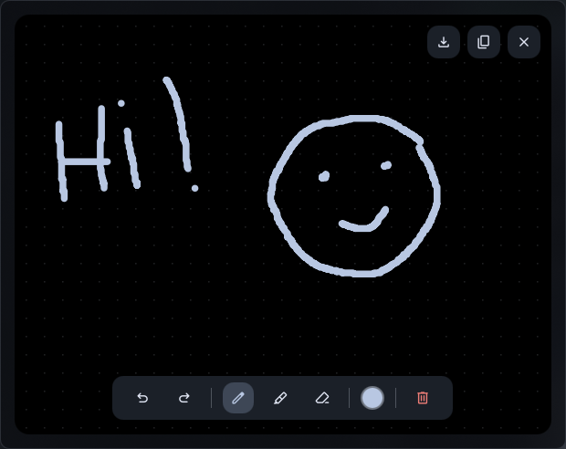

# Draw Pad

A scratch-pad popout for [Dank Material Shell](https://danklinux.com) (DMS). Click the bar icon and sketch.



## Features
- Pen, translucent marker and eraser (right-click also erases)
- Size slider and color palette with hex input
- Undo / redo (`Ctrl+Z`, `Ctrl+Shift+Z` / `Ctrl+Y`) and clear
- Save as PNG to `~/Pictures` or copy to the clipboard (needs `wl-copy`)
- Your drawing is kept while the popout is closed
- Follows the DMS theme

## Install
```sh
git clone https://github.com/SpreadSheets600/dms-drawpad ~/.config/DankMaterialShell/plugins/drawPad
dms restart
```
Then enable **Draw Pad** in DMS Settings → Plugins and add it to a Dank Bar section.

## Requirements
DMS >= 2.0.0, `wl-clipboard` for the copy button.
